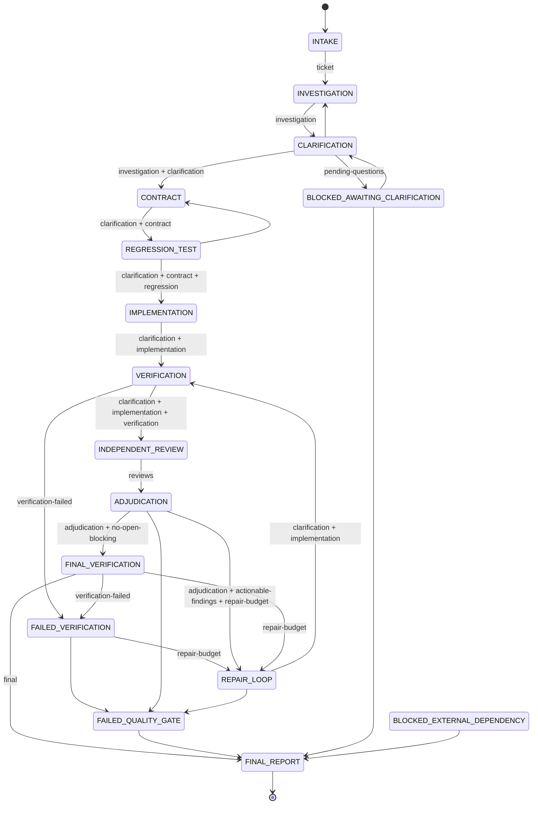

# State machine (normative source: `scripts/bug_assurance/machine.py`)

The Orchestrator can change a run's state only through `ba.py transition <TARGET>`. On every
transition the controller evaluates the target's gates **fresh from artifacts**. It refuses the move
(exit code 3) and lists the problems when any gate fails. Gate results are written to
`gate-results.json` and appended to `gate-history.jsonl`. Events go to `events.jsonl`.

Not drawn, to keep the diagram readable:
- `CONTRACT`, `REGRESSION_TEST`, `IMPLEMENTATION`, `VERIFICATION`, `FAILED_VERIFICATION`,
  `INDEPENDENT_REVIEW`, `ADJUDICATION`, `REPAIR_LOOP` and `FINAL_VERIFICATION` can all go to
  `CLARIFICATION` with no gate. From these "late" states `--reason` is mandatory (a newly
  discovered ambiguity).
- Every non-terminal state except `BLOCKED_EXTERNAL_DEPENDENCY` can go to
  `BLOCKED_EXTERNAL_DEPENDENCY` (`--reason` mandatory). The state it came from is saved in
  `state.resume_to`, and the run can return **only** to that state (or end in `FINAL_REPORT`).

## States

| State | Purpose | Expected artifacts | Allowed transitions → entry gates |
|---|---|---|---|
| INTAKE | Normalize the ticket | `ticket.json` | INVESTIGATION → `ticket` |
| INVESTIGATION | Read-only trace (ba-bug-investigator) | `understanding.json`, `investigation.md` | CLARIFICATION → `investigation` |
| CLARIFICATION | Ask→Interpret→Challenge→Verify→Follow up→Record→Gate | `decisions.json`, `clarification.json`, `answers.jsonl` | CONTRACT → `investigation`,`clarification`; BLOCKED_AWAITING_CLARIFICATION → `pending-questions`; INVESTIGATION → none |
| BLOCKED_AWAITING_CLARIFICATION | Waiting for a stakeholder answer; code frozen | `decisions.json` | CLARIFICATION → none; FINAL_REPORT → none |
| CONTRACT | Behavioral contract | `contract.json` | REGRESSION_TEST → `clarification`,`contract`; CLARIFICATION |
| REGRESSION_TEST | Failing-before-fix test | `regression-plan.json`, `regression-run.json` | IMPLEMENTATION → `clarification`,`contract`,`regression`; CONTRACT; CLARIFICATION |
| IMPLEMENTATION | Smallest correct change (ba-implementer) + diff audit | `implementation.json`, `diff-audit.json` | VERIFICATION → `clarification`,`implementation`; CLARIFICATION |
| VERIFICATION | Run repository checks | `verification/*.json` | INDEPENDENT_REVIEW → `clarification`,`implementation`,`verification`; FAILED_VERIFICATION → `verification-failed`; CLARIFICATION |
| FAILED_VERIFICATION | A required check failed or was blocked | — | REPAIR_LOOP → `repair-budget`; FAILED_QUALITY_GATE; CLARIFICATION |
| INDEPENDENT_REVIEW | Mandatory and conditional reviewers | `reviews/*.json`, `reviews-index.json`, `findings.json` | ADJUDICATION → `reviews`; CLARIFICATION |
| ADJUDICATION | Evidence-based dispositions | `findings.json` | REPAIR_LOOP → `adjudication`,`actionable-findings`,`repair-budget`; FINAL_VERIFICATION → `adjudication`,`no-open-blocking`; CLARIFICATION; FAILED_QUALITY_GATE |
| REPAIR_LOOP | Bounded targeted corrections | `implementation.json`, `diff-audit.json` | VERIFICATION → `clarification`,`implementation`; CLARIFICATION; FAILED_QUALITY_GATE |
| FAILED_QUALITY_GATE | Blocking problems cannot be repaired within limits (`--reason` required) | — | FINAL_REPORT |
| FINAL_VERIFICATION | Full required suite at the final code (`verify --final`) | `verification/*.json` | FINAL_REPORT → `final`; FAILED_VERIFICATION → `verification-failed`; REPAIR_LOOP → `repair-budget`; CLARIFICATION |
| BLOCKED_EXTERNAL_DEPENDENCY | Waiting on permissions, infrastructure or an external party | — | `resume_to` state → none; FINAL_REPORT |
| FINAL_REPORT | Terminal; report written, active pointer cleared | `final-report.md`, `final-report.json` | — |

## Gates (normative source: `scripts/bug_assurance/gates.py`)

| Gate | Passes when |
|---|---|
| `ticket` | `ticket.json` has title, symptom, expected/actual (or `UNKNOWN` with missing_information), a valid risk_level and rationale, and a well-formed source. |
| `investigation` | `investigation.md` ≥ 200 chars; `understanding.json` complete; claims and hypotheses well-formed; root_cause.status valid. |
| `clarification` | Every material, non-superseded, non-duplicate question is RESOLVED with valid provenance, all decision points settled, no unresolved contradiction, all counterexamples handled, follow-ups resolved; material CONTRADICTION/UNKNOWN/UNVERIFIED_ASSUMPTION claims are addressed; root-cause rules hold; all 10 dimensions are assessed and none is UNRESOLVED. |
| `pending-questions` | At least one material question is pending (there is something to wait for). |
| `contract` | Requirements and scenarios are consistent and cross-linked, a negative/boundary scenario exists (or is justified), required checks exist in config, and every decision/counterexample AC id is present. |
| `regression` | The pre-fix run executed against the baseline application code with the current plan, and every test was `FAILED_AS_EXPECTED`. Alternatively, an infeasible plan is justified (recorded as a risk). |
| `implementation` | `implementation.json` is complete, the diff audit is fresh, every BLOCKING/WARNING issue is fixed or acknowledged (SECRET never), and `files_changed` matches the diff. |
| `verification` | Every required check (config `required` + contract `required_checks` + `regression:<id>`) has a PASS result at the current fingerprint. |
| `verification-failed` | The `verification` gate does **not** pass. |
| `final-verification` | Like `verification`, but taken from a single `--final` run at the current fingerprint. |
| `reviews` | Mandatory reviewers COMPLETED and conditional reviewers COMPLETED or NOT_APPLICABLE (with rationale), all at the current fingerprint. |
| `adjudication` | Every finding has a disposition other than NEEDS_CLARIFICATION/UNRESOLVED, and no logged finding has disappeared. |
| `actionable-findings` | At least one CONFIRMED, OPEN, non-informational finding exists. |
| `no-open-blocking` | `adjudication` (final mode) passes: no CONFIRMED CRITICAL/HIGH/MEDIUM finding is still OPEN. |
| `repair-budget` | `repair.cycles < repair.max_cycles`. |
| `final` | clarification + contract + regression + implementation + final-verification + reviews + adjudication(final). |

## Repair counter

Entering `REPAIR_LOOP` increments `state.repair.cycles`. `max_cycles` is copied from config when
the run starts (default 3). Editing config later does not change it. It can be changed only with
`ba.py set-repair-limit N --authorization A-…` (an AUTHORIZED answer), and never above
`hard_limit` (≤ 10).

## Edit policy enforced by the PreToolUse hook

| State | Application / other source | Tests | Agent-owned run artifacts | Script-owned artifacts |
|---|---|---|---|---|
| INTAKE … CONTRACT, waiting/failure states | deny | deny | allow | deny |
| REGRESSION_TEST | deny | allow if clarification gate passes | allow | deny |
| IMPLEMENTATION, REPAIR_LOOP | allow if clarification gate passes (live) | allow if clarification gate passes | allow | deny |

`.claude/**`, `.github/**` and `.bug-assurance/config.json` → **ask** while a run is active.
Read-only reviewer agents (`agent_type` ba-*-reviewer, ba-bug-investigator, ba-findings-adjudicator)
are denied writes to project files.
