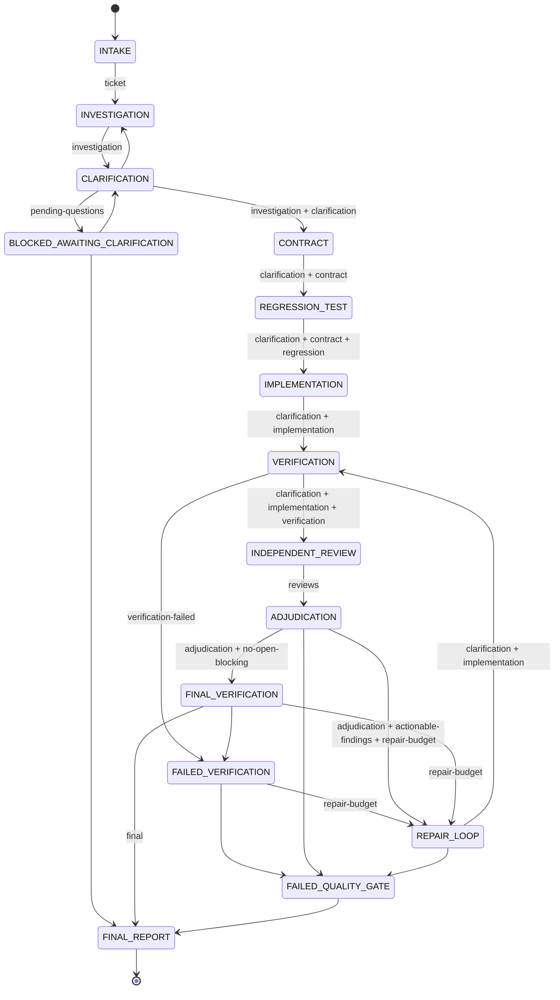

# Architecture

## Components

```
.claude/skills/bug-assurance/
  SKILL.md                 Orchestrator protocol (main thread follows it)
  reference/, templates/   Artifact formats and JSON templates (`ba.py template <name>`)
  scripts/ba.py            Deterministic controller (stdlib Python)
  scripts/bug_assurance/
    core.py      config, run storage, redaction, glob matching, atomic JSON I/O
    machine.py   state machine: the only code that changes run state
    gates.py     every gate, computed from artifacts
    ledger.py    user-message capture, answer provenance, pending-question batch
    checks.py    verification runner (real exit codes, timeouts, honest statuses)
    audit.py     snapshots, fingerprints (staleness), diff audit
    findings.py  review ingestion, evidence-based adjudication, resolutions
    report.py    final / draft report and status computation
    guard.py     Claude Code hook handlers
    bootstrap.py discover / init / install
    ghstatus.py  workflow validation, CI / required-check / CodeRabbit status (read-only)
.claude/agents/ba-*.md     orchestrator (optional main-thread agent) + 8 specialists
.claude/settings.json      project hooks + permission rules
.bug-assurance/config.json repository-specific paths, checks, reviewers, limits
.bug-assurance/runs/<id>/  per-run artifacts (gitignored)
```

## Who decides what

| Concern | Decided by | Mechanism |
|---|---|---|
| Current state, allowed transitions | `machine.py` | `ba.py transition` evaluates the target's gates. If any fails, it refuses with exit code 3 |
| Whether a gate passes | `gates.py` | Computed from artifacts. Agent-written statuses are cross-checked against evidence |
| Whether application code may change | `guard.py` (PreToolUse hook) | State must be IMPLEMENTATION / REPAIR_LOOP **and** the clarification gate must pass *live* at that moment |
| Whether a check passed | `checks.py` | Real exit code. A missing executable is BLOCKED. A check not selected is NOT_RUN |
| Whether evidence is current | `audit.py` fingerprints | Verification, reviews and the diff audit are bound to a project fingerprint. Any change makes them stale |
| What to ask, how to interpret, what to implement | the model (Orchestrator + agents) | Guided by SKILL.md. Its *outputs* are validated by the gates |
| Business decisions | authorized stakeholder | Answers are recorded with provenance (`ba.py answer`) |

The model cannot move the workflow forward by claiming success. It can only produce artifacts
that the deterministic gates accept.

## State machine



Not drawn above:
- Every state from CONTRACT through FINAL_VERIFICATION can return to CLARIFICATION. A return from
  CONTRACT or later requires `--reason`, because it records a newly discovered ambiguity.
- Every non-terminal state can enter BLOCKED_EXTERNAL_DEPENDENCY (`--reason` required) and return
  only to the state it was blocked from.
- REPAIR_LOOP increments the cycle counter on entry and is refused at `max_cycles` (default 3,
  hard limit 10). Raising the limit requires an AUTHORIZED answer (`ba.py set-repair-limit N
  --authorization A-xxx`).
- FAILED_QUALITY_GATE requires `--reason`.
- On FINAL_REPORT the controller writes `final-report.md` / `.json` and clears the active-run
  pointer.

`ba.py status` lists every allowed transition from the current state and whether its gates
pass right now, along with the blocking problems.

## Gates (normative definitions in `gates.py`)

| Gate | Key conditions |
|---|---|
| `ticket` | Title, symptom, expected and actual behavior (`UNKNOWN` only if listed in missing_information), risk level and rationale, source `{kind, ref, accessed}` |
| `investigation` | `investigation.md` ≥ 200 chars. Bug model fields and behavior model (preconditions → action → expected transition → side effects). Claims classified with the 7-level evidence hierarchy. ≥ 1 hypothesis with a distinguishing test. Root-cause status |
| `clarification` | Every material question RESOLVED (or duplicate of a resolved one / superseded). ≥ 2 interpretations. All decision points covered. Analysis with a restated rule, hidden assumptions, contradictions (none UNRESOLVED) and counterexamples (none UNHANDLED; follow-ups resolved). **Business rules cannot be settled by repository evidence or inference**: they need an AUTHORITATIVE_REQUIREMENT claim (verbatim quote checked against a repo file, or an authorized answer) or an AUTHORIZED_DECISION. Overriding authoritative evidence must be listed in `supersedes`. Material CONTRADICTION / UNKNOWN / UNVERIFIED_ASSUMPTION claims must be addressed. Root cause CONFIRMED needs direct evidence (reproduction/test/trace/log…), no unexplained contradicting evidence and all competing hypotheses REFUTED. PROBABLE/UNCONFIRMED is allowed only at low/medium risk, with a diagnostic limitation, and is recorded as a risk. All 10 dimensions assessed with refs |
| `contract` | Requirements with source, authority, ACs and a verification test (or impractical_reason). Given/When/Then scenarios linked to requirements. ≥ 1 negative/boundary scenario. Every resolved decision maps to existing ACs. No open conflicts. Required checks exist in config |
| `regression` | Plan tests cover ACs. Pre-fix run executed by `ba.py regression-run` **against the original application fingerprint**, with every test FAILED_AS_EXPECTED (a test that passes on the buggy code is rejected). The plan must be unchanged since the run. If infeasible, a reason and alternative are required (recorded as a risk) |
| `implementation` | Summary, decisions and limitations. Fresh diff audit. Every BLOCKING/WARNING issue fixed or acknowledged with justification (secrets can never be acknowledged). Changed files match the summary |
| `verification` | Every required check (config + contract + `regression:<id>`) PASS at the current fingerprint |
| `final-verification` | The same, but from a single `verify --final` run at the current fingerprint |
| `reviews` | Mandatory reviewers COMPLETED at the current fingerprint. Security COMPLETED or NOT_APPLICABLE with a rationale |
| `adjudication` | Every finding dispositioned. None NEEDS_CLARIFICATION / UNRESOLVED. No finding missing from the log. In the final form, blocking CONFIRMED findings (CRITICAL/HIGH/MEDIUM) are FIXED or ACCEPTED_RISK |
| `final` | clarification + contract + regression + implementation + final-verification + reviews + final adjudication |

## Provenance model

- **User messages.** The UserPromptSubmit hook appends each prompt, redacted, to
  `.bug-assurance/inbox.jsonl` with a SHA-256 of the stored text. Records whose hash does not
  match are ignored, so tampering is detected. Harness-generated turns (background-task
  notifications, subagent hand-backs, system reminders) also reach UserPromptSubmit; they are
  filtered at capture and ignored on read (`ledger.is_system_generated`), so agent output can
  never pose as a user decision. Capture is on by default (`guard.capture_prompts`).
- **User answers.** `ba.py answer Q-n --source-kind user --from-message M-… --quote "<excerpt>"`
  works only if the excerpt appears verbatim (whitespace- and case-normalized) in that captured
  message. The gate re-verifies this every time.
- **Document answers / authoritative claims.** The quote must appear verbatim in an existing
  repository file (`source_path` + `quote`).
- **Agent and unsourced-ticket statements** are recorded as `UNVERIFIED` and cannot authorize a
  business decision.
- Answers are append-only in the script-owned `answers.jsonl`.

## Fingerprints and staleness

`audit.snapshot()` hashes every tracked and untracked-but-not-ignored file, excluding
`.bug-assurance/`, `.git/` and build caches. The fingerprint is stamped on verification runs,
review records and the diff audit. A gate accepts that evidence only if its fingerprint equals the
current one. If files change while checks run, the verification record is marked `INCONSISTENT`
and is unusable. The baseline taken at `start` provides the original application fingerprint
used by the pre-fix regression run, and the list of files that already had uncommitted user
changes.

## Script-owned vs. agent-owned artifacts

| Script-owned (hook denies direct edits) | Agent-owned (validated by gates) |
|---|---|
| `state.json`, `events.jsonl`, `baseline.json`, `answers.jsonl`, `findings.json`, `findings-log.jsonl`, `reviews-index.json`, `regression-run.json`, `diff-audit.json`, `verification/`, `gate-results.json`, `gate-history.jsonl`, `final-report.*`, `draft-report.md`, plus `.bug-assurance/inbox.jsonl` and `active-run` | `ticket.json`, `understanding.json`, `investigation.md`, `decisions.json`, `clarification.json`, `contract.json`, `regression-plan.json`, `implementation.json`, `reviews/`, `notes/`, `evidence/` |

## Hooks: what they can and cannot stop

| Hook | Enforces | Limits |
|---|---|---|
| PreToolUse (Edit/Write/MultiEdit/NotebookEdit) | Application files are denied outside IMPLEMENTATION/REPAIR_LOOP or while the live clarification gate fails. Tests are denied before REGRESSION_TEST. Script-owned evidence is always denied. `.claude/`, `.github/` and config changes during a run prompt the user. Read-only `ba-*` agents cannot write project files | Inactive when no run is active, except for the evidence protection and the git ask |
| PreToolUse (Bash/PowerShell) | Asks before commit, push, merge, rebase, `reset --hard`, `clean -f`, `checkout --`, `restore`, `gh pr create`, `--no-verify`, and similar. Denies deleting `.bug-assurance`. Denies redirect/tee/`Set-Content` writes into protected files and asks for other write-like commands that name them | **Heuristic, defense in depth only.** A sufficiently indirect program (for example a script that writes files) is not detected. The diff audit and fingerprints catch the result afterwards |
| UserPromptSubmit | Captures messages for provenance. Reminds the model to record answers | Captures only when `.bug-assurance/` exists and `guard.capture_prompts` is true |
| SessionStart | Injects the active run's state for resumption | None |
| Stop | Blocks **once** (it honors `stop_hook_active`) when the run is left mid-flight, or when pending questions exist but the wait was not persisted | It does not fire for subagents |

On an internal guard error during an active run, a write is escalated to the user (`ask`) rather
than silently allowed. On malformed hook input the guard makes no decision.

## Failure modes and responses

| Failure | Behavior |
|---|---|
| Malformed artifact JSON | The gate reports the parse error. The transition is refused |
| Config invalid | `BAError` lists the problems. The guard escalates writes to the user |
| Required tool missing | Check is BLOCKED. Verification gate fails. Report status BLOCKED/FAIL, never PASS |
| Check hangs | Killed at `timeout_s` and reported as FAIL with "timed out" |
| Code changes after verification | Evidence goes stale. Re-run `verify` / re-review |
| Repair cycles exhausted | REPAIR_LOOP refused. Go to FAILED_QUALITY_GATE, then FINAL_REPORT (FAIL/BLOCKED) |
| Crash mid-write | Atomic temp-file + rename. The JSONL logs are append-only |
